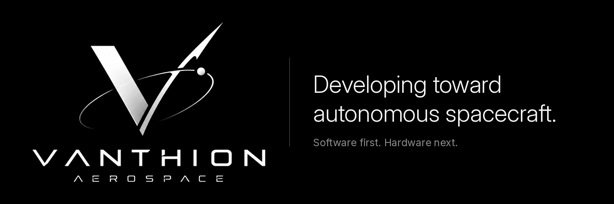

<p align="center">
  
</p>

<h1 align="center">Intelligent, resilient spacecraft systems.<br>Built from first principles.</h1>

Vanthion Aerospace is an early-stage Indian aerospace venture. We are developing the foundations for autonomous spacecraft, starting with software and telemetry intelligence and progressing toward integrated hardware validation and, in time, a potential orbital technology demonstration.

We are not yet a satellite manufacturer, a launch provider, or an operator of flight-proven systems. This page states what exists, what is being built, and what remains unproven.

| Today | |
|:--|:--|
| **Stage** | Early-stage engineering venture |
| **Current work** | Spacecraft telemetry intelligence, simulation, embedded sensor interfaces |
| **Flagship platform** | SATSentinel-X |
| **Proposed mission** | SX-OD1, a CubeSat technology demonstration (concept only) |
| **Flight status** | None. No launch date, contract, or flight qualification exists. |

---

## Mission

Spacecraft far from help must increasingly recognise, interpret, and respond to their own faults. Vanthion Aerospace exists to build the engineering foundations for that capability in the order that makes it trustworthy: measure first, simulate carefully, validate on hardware, and only then consider flight.

The approach is software-first and capital-conscious. Each stage is expected to produce evidence before the next is attempted.

---

## Programme architecture

| Level | Name | Role |
|:--|:--|:--|
| Company | **Vanthion Aerospace** | The organisation. |
| Platform | **SATSentinel-X** | Software platform for AI-assisted spacecraft telemetry intelligence, with autonomous fault management as its long-term direction. In development. |
| Mission | **SX-OD1** | Proposed CubeSat technology-demonstration mission. Concept only: no confirmed specification, payload, orbit, launch provider, or approval. |

```text
Vanthion Aerospace
├── SATSentinel-X    software platform          in development
└── SX-OD1           proposed CubeSat mission   concept
```

SATSentinel-X and SX-OD1 are distinct. The proposed spacecraft is not integrated with SATSentinel-X, and the two are not interchangeable.

---

## SATSentinel-X

<p align="center">
  
</p>

**AI-Assisted Spacecraft Telemetry Intelligence Platform**

The intended capability progression is:

> Telemetry acquisition → anomaly detection → fault diagnosis → constrained response selection → recovery verification

This is a development direction. It is not a claim that all five capabilities are implemented.

### What exists today

**Simulation.** A telemetry simulator with 24 channels across six subsystems (power, thermal, communications, attitude control, propulsion, payload) and five injectable fault scenarios. It uses an illustrative low Earth orbit cycle with an approximately 90-minute period and approximately 36-minute eclipse, and generates a development dataset of 6,500 labelled frames.<br>
*Boundary:* a simplified, physics-inspired model. Not a digital twin, not a complete physical satellite model, not real orbital telemetry.

**Real-data evaluation.** A forensic evaluation of a frozen detector on ESA Mission-1 telemetry, an OPS-SAT-AD protocol stress test, and an actual Yamcs 5.13.2 ground-system pathway.<br>
*Boundary:* population-specific results with documented limitations. Not operational or flight validation.

**Physical demonstrator.** A designed ESP32 and BME280 acquisition path over USB serial into a Python receiver that fails closed on its acceptance checks, a local dashboard, a synthetic replay, and a deterministic synthetic power-recovery policy demonstrator.<br>
*Boundary:* a ground-based engineering demonstrator. The 60-second hardware acceptance run has not yet been completed. Not a space-qualified onboard computer.

---

## Autonomy philosophy

Spacecraft autonomy requires considerably more than anomaly detection. Detection is only one of five distinct problems.

**Observe.** Acquire and interpret telemetry across subsystems.<br>
*Today:* implemented in the simulator and serial receiver.

**Detect.** Identify meaningful deviations, and measure false alarms and missed detections.<br>
*Today:* research detectors are evaluated, with false-alarm burden reported rather than hidden.

**Diagnose.** Investigate plausible fault sources and interactions between subsystems.<br>
*Today:* an early prototype in simulation. Not validated.

**Decide.** Evaluate possible responses against explicit operational constraints and safety requirements.<br>
*Today:* a deterministic synthetic policy demonstrator only. No hardware is commanded.

**Verify.** Determine whether the intended outcome occurred, and escalate if it did not.<br>
*Today:* a synthetic demonstrator only. Recovery is declared after subsequent verified samples; otherwise the condition escalates.

This is the intended autonomy architecture, not a statement that every stage is operational.

Five commitments shape how it is built:

- **Reproducibility.** Evaluations are frozen, versioned, and re-runnable.
- **Explicit limitations.** Every result is published with its population, protocol, and boundary.
- **Controlled fault injection.** Behaviour is tested against known, repeatable faults.
- **Measurable evaluation.** False alarms and missed detections are counted, not described.
- **Safe-state behaviour.** Unresolved conditions escalate; an action is never assumed to have worked.

---

## Engineering domains

| Domain | Focus |
|:--|:--|
| **Telemetry intelligence** | Interpreting multi-channel spacecraft telemetry; evidence-based anomaly detection |
| **Fault management** | Diagnosis, constrained response selection, recovery verification, escalation logic |
| **Embedded systems** | Sensor interfaces, serial protocols, fail-closed data acquisition |
| **Simulation and fault injection** | Reproducible nominal and faulted operating scenarios |
| **Ground systems** | Telemetry ingestion and parameter pathways through Yamcs |
| **Validation and evidence** | Frozen evaluations, claim-to-evidence audits, integrity manifests |

---

## Development roadmap

| Status | Stage |
|:--|:--|
| `IN DEVELOPMENT` | **Software and telemetry simulation.** Simulator, evaluation tooling, and evidence audits exist and continue to be tested. |
| `INTEGRATION` | **Embedded hardware and physical sensor interfaces.** Firmware and host receiver prepared. Physical acceptance test pending. |
| `PLANNED` | **Hardware-in-the-loop validation.** No hardware-in-the-loop results exist yet. |
| `RESEARCH DIRECTION` | **Constrained autonomous fault management.** A synthetic policy demonstrator provides groundwork. No onboard implementation exists. |
| `LONG-TERM OBJECTIVE` | **Potential orbital technology demonstration.** Proposed concept (SX-OD1). No launch date, contract, or qualification is confirmed. |

No percentages, completion bars, or dates are shown, because none would be honest at this stage.

---

## Selected repositories

| Repository | Owner | Description |
|:--|:--|:--|
| [SATSentinelX_Telemetry](https://github.com/VANTHION-AEROSPACE/SATSentinelX_Telemetry) | Vanthion Aerospace | Real-telemetry evaluation workspace, Yamcs integration pathway, and the [ESP32 and BME280 physical demonstrator](https://github.com/VANTHION-AEROSPACE/SATSentinelX_Telemetry/tree/main/physical_demo). |
| [SATSentinel-X](https://github.com/aadityat23/SATSentinel-X) | Founder's personal account | Telemetry simulator, early detection prototype, API, and dashboard, with a V2.1 re-evaluation specification. Not currently an organisation repository. |

---

## Research and validation

Credibility in this field comes from stating what a result does not show. The evaluation of SATSentinel-X's detector on real ESA telemetry is reported that way.

| Result | Qualification |
|:--|:--|
| A frozen detector flagged all 30 evaluated labelled anomaly events (ESA Class-3). | Small positive population. The same detector flagged 40 of 170 label-negative or unlabelled control periods (23.5%), and those controls are not confirmed nominal. |
| A second detector formulation was tested against the first. | It did not improve on it. Reported as a negative result. |
| OPS-SAT-AD was run as a protocol stress test. | Not validation of the frozen detector. Discrimination was weak (ROC-AUC 0.48). |
| An actual Yamcs 5.13.2 pathway passes a real-data smoke test. | Five of six fixed equivalence cases pass. One remains incomplete because of archive coverage. |

These results are descriptive. They do not establish operational performance, flight readiness, or general accuracy. The [research evidence](https://github.com/VANTHION-AEROSPACE/SATSentinelX_Telemetry/tree/main/research) is public.

---

## Founder

Vanthion Aerospace is founded by **[Aaditya Thokal](https://github.com/aadityat23)**, an independent researcher building the company while pursuing engineering and data science studies in India.

---

## Collaboration

Outside expertise would change this work most in these areas:

- **Spacecraft fault management and systems engineering.** Review of the autonomy architecture, fault models, and escalation logic.
- **Nominal-operations telemetry.** The main limitation of current evaluations is the absence of confirmed-nominal control data.
- **Ground-segment practice.** Telemetry database design and Yamcs deployment experience.
- **Embedded and hardware validation.** Review of sensor interfaces, firmware, and hardware-in-the-loop test design.
- **Academic and research review.** Independent reproduction and critique of the evaluations.

To start a conversation, write to [vanthion.aerospace@gmail.com](mailto:vanthion.aerospace@gmail.com).

---

## Links

| Channel | Link |
|:--|:--|
| GitHub | [VANTHION-AEROSPACE](https://github.com/VANTHION-AEROSPACE) |
| LinkedIn | [Vanthion Aerospace](https://www.linkedin.com/company/vanthion-aerospace) |
| Email | [vanthion.aerospace@gmail.com](mailto:vanthion.aerospace@gmail.com) |
| Founder | [aadityat23](https://github.com/aadityat23) |

---

<p align="center"><em>Autonomy is not declared. It is demonstrated, one verified behaviour at a time.</em></p>

<p align="center"><sub>This page describes engineering work in progress. Nothing here implies flight heritage, space qualification, institutional endorsement, or a scheduled launch.</sub></p>
